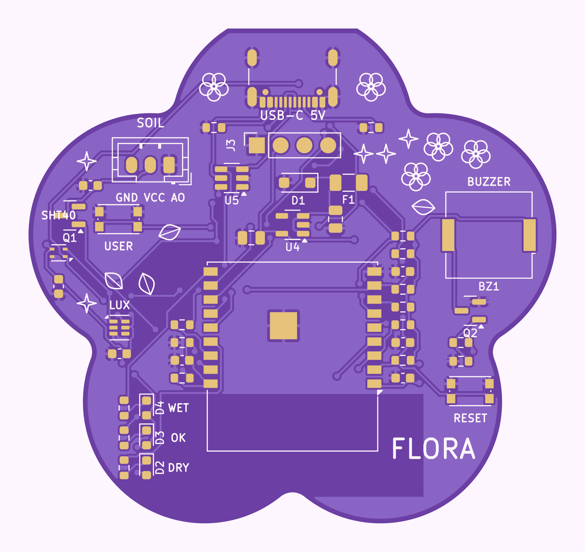

# FLORA — Smart Plant Companion 🌸

🇪🇸 **[Versión en español → README.md](README.md)**

**Author:** Francesca Martínez · [@frandorturtles](https://github.com/frandorturtles) · **Website:** https://frandorturtles.github.io/FLORA/ (after enabling GitHub Pages, see below; the page has an ES/EN switch)

A plant monitor built on an **ESP32-C3** on a **flower-shaped PCB** (5 petals, 56.5 × 53 mm, 2 layers, 2 × M2 mounting holes, “frandorturtles” signed on the silkscreen).
It measures soil moisture (capacitive probe), air temperature and humidity (SHT40) and light (TSL25911), and shows them on an OLED display with status LEDs and an optional buzzer alert. Powered over USB-C (5 V).



> **Honest status (v0.2): the design is complete and checked with automated tools, but it has NOT been fabricated and NOT been tested on hardware.**
> Image colors are for presentation only; the real solder-mask color depends on the manufacturer.

## What is in this repository
| Folder | Contents |
|---|---|
| `hardware/` | KiCad project (`FLORA.kicad_pro/.kicad_sch/.kicad_pcb`), custom symbol, BOM, pinout, Gerbers, drill files, pick-and-place, generator scripts |
| `firmware/` | ESP32-C3 firmware (Arduino/PlatformIO), logic tested on a PC and a syntax check |
| `documentation/` | Architecture, electrical design, assembly, test plan, BOM, ERC, design review (in Spanish) |
| `manufacturing/` | Fabrication notes, assembly notes, checklist and the Gerber ZIP (in Spanish) |
| `renders/` | Top/bottom views (rendered from the Gerbers), fabrication view and a STEP model of the bare board |
| `website/` and `docs/` | The purple FLORA website (`docs/index.html` is served by GitHub Pages) |
| `portfolio/` | Case-study page (ES/EN) and texts for a portfolio |

## Features (v0.2)
Calibratable soil moisture (dry/wet) · ambient temperature and RH · light · 0.96" OLED · 3 LEDs (dry / OK / too wet) · mutable buzzer · user button + reset · configurable thresholds · disconnected-probe warning · 10 test points · USB-C 5 V (no PD) · 2 × M2 holes · **no automatic watering, no battery**.

## Verification
| Check | Status |
|---|---|
| Schematic netlist = design model | ✅ automatic (`check_netlist.py`) |
| Custom ERC on the netlist (pin types, power nets, pins vs. footprints) | ✅ 0 errors, 0 warnings — **it does not replace the official ERC** (`documentation/erc_report.md`) |
| Official KiCad ERC | ❌ not run (the KiCad 7 CLI does not include it): run it in KiCad (Inspect → Electrical Rules Checker) or with CI |
| PCB DRC (KiCad 7.0.11, **on the very file delivered**) | ✅ 0 errors, 0 unconnected pads. Remaining: “library not configured” warnings (run without a library table) and 1 silkscreen warning |
| Gerbers from the same file, read with an independent viewer (gerbonara) and visually reviewed | ✅ |
| Firmware logic (PC tests, g++) | ✅ |
| Firmware syntax/type check against mock Arduino headers | ✅ (`firmware/test/syntax_check.sh`) |
| Real firmware build for ESP32-C3 | ❌ not possible in the dev environment (toolchain download blocked): run `pio run` or the CI |
| Pinouts checked against datasheets | ✅ ESP32-C3-WROOM-02, TSL25911FN, AP2112K, USBLC6-2SC6, SMF5.0CA · ⚠️ SHT40, AO3401A, 2N7002, USB-C, buzzer: only official KiCad symbols |
| Fabrication, assembly, physical tests | ❌ pending (`documentation/testing_plan.md`) |

Full list of limitations: `documentation/design_review.md` (Spanish).

## Publish to your GitHub (@frandorturtles)
```
cd FLORA
git init -b main
git add .
git commit -m "FLORA v0.2: hardware, firmware, documentation and website"
git remote add origin https://github.com/frandorturtles/FLORA.git   # first create the empty repo "FLORA" at github.com/new
git push -u origin main
```
Then on GitHub: **Settings → Pages → Deploy from a branch → `main` / folder `/docs`**. Under **About** add a description and topics: `esp32-c3`, `kicad`, `pcb`, `plant-monitor`, `platformio`, `open-hardware`.

## Getting started
1. **Open:** `hardware/FLORA.kicad_pro` in KiCad 10 (the schematic and board files are in KiCad 7 format; KiCad 10 upgrades them on save). Run ERC and DRC.
2. **Fabricate:** `manufacturing/fabrication_notes.md` and `manufacturing/FLORA_gerbers_for_fab.zip` (re-plot from KiCad 10 if you prefer, see `gerber_checklist.md`).
3. **Buy parts:** `hardware/bom.csv` (check stock and part numbers first).
4. **Assemble:** `documentation/assembly_guide.md`.
5. **Firmware:** `firmware/README.md`.
6. **Test:** `documentation/testing_plan.md`.

## Regenerate the hardware from scratch
See `hardware/scripts/README.md`.

## License
MIT (see `LICENSE`). You can change the hardware license (for example CERN-OHL-P or CC BY 4.0).
